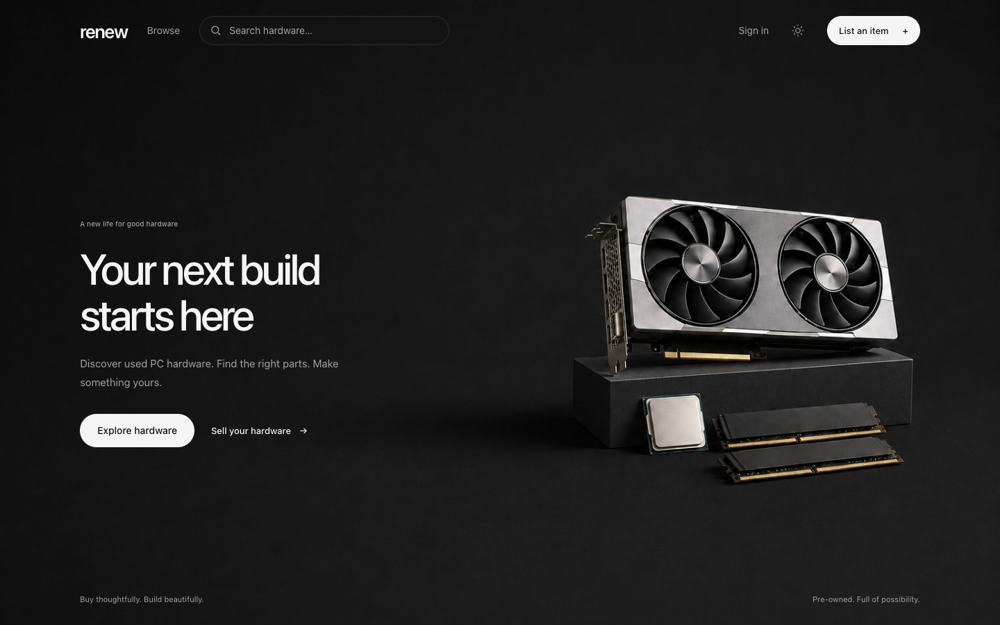

# Renew

Renew is a marketplace for secondhand PC hardware. Sellers pair each listing with a condition report and proof photos, giving buyers more to go on than a product name and a price. Buyers can compare parts, save listings, and talk directly with sellers before arranging a purchase.



## What the app does

- **List and discover hardware.** Sellers can create, edit, mark as sold, and remove listings. Buyers can search and filter by category, condition, location, price, power draw, and photo verification status.
- **Show the evidence.** Listings include seller-entered diagnostics such as condition grade, benchmark score, power draw, and boot status, alongside photos organized by proof type.
- **Connect buyers and sellers.** Each conversation belongs to a listing. Messages arrive through Supabase Realtime, and image attachments are stored privately and served only to conversation participants.
- **Support different currencies.** Sellers set an asking price in a supported currency. Buyers can view an approximate conversion in their preferred currency while the original asking price stays visible.
- **Help sellers prepare a listing.** When a Gemini API key is configured, sellers can ask AI to suggest diagnostic fields from their photos. Renew also checks whether the photos support the published claims and shows the result on the listing. Listing creation still works when AI is unavailable.
- **Manage an account.** Users can save listings, manage their own listings, update profile details, and set a preferred display currency. The FAQ includes an optional, signed-in support chat grounded in the site's help content.

The **Buy Now** button opens a conversation with the seller. Renew does not currently process checkout or payments; buyers and sellers arrange the transaction directly.

## How it's built

Renew uses **Next.js 15**, **React 19**, **TypeScript**, and **Tailwind CSS 4**. Server Components load marketplace data through Prisma; Server Actions handle listing, account, and messaging changes with server-side authentication and authorization checks. Supabase provides Postgres, email/password and Google authentication, Storage, and Realtime message delivery.

The listing and avatar images live in a public Storage bucket. Chat attachments use a separate private bucket and an authenticated route that checks conversation membership before serving an image. Images are compressed with `sharp` before upload. Gemini powers the optional photo and FAQ features; approximate currency conversion uses exchange rates from Frankfurter.

The code is organized around user flows: routes and actions in `app/`, UI in `components/`, shared data and service code in `lib/`, and the database schema and migrations in `prisma/`.

## Run locally

You'll need Node.js, npm, and a Supabase project. Start with the variables in [`.env.example`](./.env.example):

```bash
npm install
cp .env.example .env.local
```

Fill in the database URLs, Supabase project URL, publishable key, and server-only secret key in `.env.local`, then copy it to `.env` for the Prisma CLI:

```bash
cp .env.local .env
```

Next.js reads `.env.local`. `GEMINI_API_KEY` is optional and enables photo verification, diagnostic autofill, and the FAQ support chat.

In Supabase Storage, create a **public** bucket named `listing-photos` for listing photos and avatars. Configure Storage policies to allow authenticated users to upload and remove photos through the app. This bucket is not created by the Prisma migrations. Create the **private** chat attachment bucket with the included script:

```bash
npm run setup:chat-bucket
npm run prisma:migrate
npm run dev
```

Open [localhost:3000](http://localhost:3000). To add sample sellers and listings, run `npx prisma db seed`. Seed images are served from `public/demo/`; the seed does not upload them to Storage.

For other workflows, use `npm run lint`, `npm run build`, or `npm run prisma:studio`. The build script applies pending Prisma migrations before building.

Run `npm test` for the offline tests. Browse query integration tests also run when
`BROWSE_TEST_DATABASE_URL` points to a migrated local PostgreSQL database named
`renew_browse_test`. They create and remove their own fixtures; never use the app's
database for these tests. Apply migrations to that isolated database by setting both
`DATABASE_URL` and `DIRECT_URL` for `npx prisma migrate deploy`, then run
`BROWSE_TEST_DATABASE_URL=postgresql://USER@localhost:5432/renew_browse_test npm test`.
